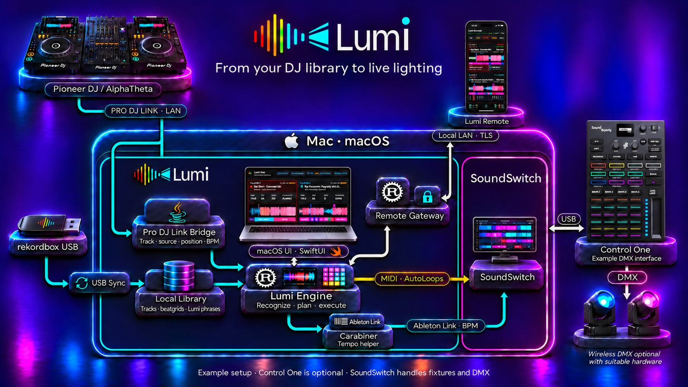
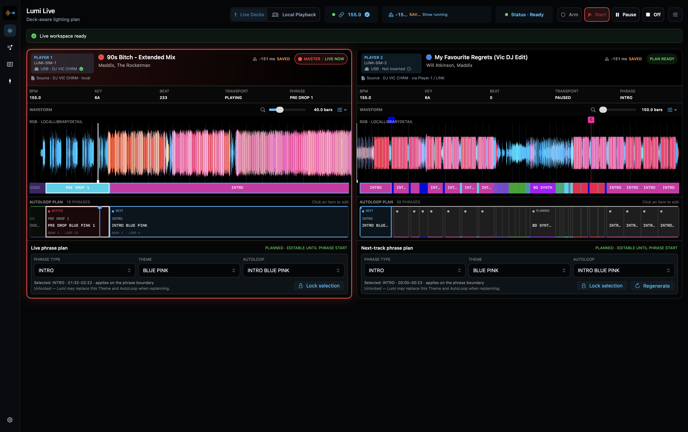

# How Lumi fits into your setup

Lumi connects your prepared music library to your live lighting choices.
Everything runs locally: the Mac owns the show, the iPhone is a remote,
and SoundSwitch controls the fixtures.

*Illustrated example setup. Control One is optional. Wireless DMX requires
suitable hardware. Click the image to view the full-size original.*

## Prepare from USB

Export your tracks from rekordbox to USB, then select the playlists to sync
into Lumi. The local library stores imported analysis and your Lumi phrases;
the engine uses them to prepare Light Plans before playback.

[USB sync and the local library](usb-sync-and-library.md)

## Follow the live Players

The Pro DJ Link bridge supplies track, source, position and BPM information.
The engine matches the loaded track to the library and executes its plan.
The macOS interface displays and controls that state; it is not the timing engine.

This actual Live view was captured using the Pro DJ Link simulator. Player 1
is playing **90s Bitch**; Player 2 holds **My Favourite Regrets**, loaded over
LINK from Player 1's USB. The source of a loaded track and the USB physically
inserted in its Player are shown separately.

## Send lighting choices and tempo separately

- **MIDI** selects the mapped SoundSwitch AutoLoops and verified Static Looks.
- **Carabiner / Ableton Link** carries the master tempo to SoundSwitch.
- **SoundSwitch** runs the lighting effects and sends DMX through its interface.

These are separate paths: sharing tempo is not proof of the physical lights'
beat alignment. Test your complete setup and timing before a show.
Control One can also remain available for manual operation alongside Lumi.

## Control from iPhone

Lumi Remote connects to the Mac's separate Remote Gateway over the local network
using paired, pinned TLS. It displays Live state and sends supported controls;
it does not carry audio or sit in the lighting execution path. Disconnecting
the phone does not stop the Mac's show.

[Install and pair Lumi Remote](iphone-remote.md)

## Under the hood

The Mac interface uses SwiftUI; the engine and Remote Gateway use Rust.
The Pro DJ Link bridge uses Java, while Carabiner provides the Ableton Link
connection. The illustration is an overview, not an exact process or network
protocol diagram. For implementation details, see the
[architecture documents and decisions](../architecture/README.md).

[Back to the user guide](README.md)
