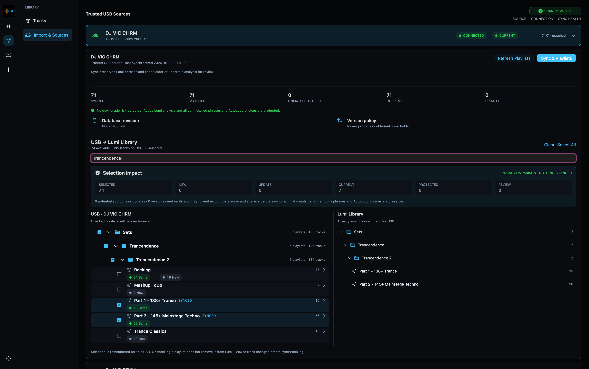
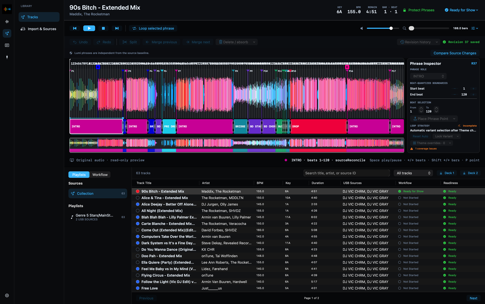

# USB sync and your local library

Prepare your music in rekordbox, export it to USB, then bring the playlists you
need into Lumi. Your local Lumi library holds the imported track analysis and
your own lighting preparation, so you do not have to start again each time you
update a USB.

**The direction is USB → Lumi, not Lumi → rekordbox.** Sync reads rekordbox data;
it does not write your Lumi phrases back to the USB or alter your rekordbox
beatgrids, cues or playlists.

## Choose what comes into Lumi

The left tree shows the USB playlists selected for synchronization; the right
tree shows what is already stored from that source. In this example, two
playlists are selected and already synced. The other visible playlists remain
unchecked. Unchecking a playlist does not delete its existing Lumi data.

1. Finish exporting in rekordbox, then connect the USB to your Mac.
2. Open **Library → Import & Sources**. For a new source, choose **Add USB
   Source…** and grant access through the normal macOS folder picker.
3. Expand that USB and scan/refresh its playlists. Browse the original folders
   and select the playlists you want to synchronize.
4. Compare the USB selection with the playlists already stored in Lumi. Check
   the track counts and changes before pressing **Sync**.
5. Wait for the completion report. Resolve any reviews or skipped tracks before
   relying on them in a show, then eject the USB safely.

Scanning and synchronizing are different: a scan previews the source and its
differences; **Sync** imports the selected tracks and updates eligible data.
A green status on one source does not mean that every playlist on that USB has
been imported. Always check the selected and stored playlists.

Each trusted USB has its own identity and sync selection. Two sticks containing
similar music remain separate sources, even if they have the same make and
model. Register and synchronize each stick you intend to use on the Players.
On a writable USB, Lumi may add a small `.lumi-media.json` identity file; this
contains identity information, not music or your lighting preparation.

## Understand changes before accepting them

Lumi imports the available track metadata, track color, beatgrid, waveform,
Hot Cues and source phrase analysis. Your Lumi-authored phrases remain separate.

| Status | What it means for your decision |
| --- | --- |
| New | A track is available to add to your local library. |
| Same / Current | The compared analysis is current, or you explicitly chose to retain the Lumi version. It does not mean every USB playlist is selected. |
| Update | Lumi can apply an eligible source update. This is not a statement that the entire USB or audio file is newer. |
| Held | Older USB analysis is retained as a source record rather than replacing the active Lumi analysis. |
| Review | Source data differs and needs your decision before replacing the retained Lumi analysis. |
| Skipped | Lumi could not safely import a track, for example because its beatgrid is invalid. Check the named track and the reason. |

For a review, inspect **what changed**—file data, beatgrid, cues, waveform or
source phrases—rather than relying only on a timestamp. A recent rekordbox
export does not necessarily prove that every component is newer than the one
already in Lumi. If the available evidence cannot establish that order, Lumi
keeps the existing analysis until you decide.

- **Later** hides the item until you reopen the screen; nothing is saved or synchronized.
- **Keep Lumi** retains the current version and remembers the decision for that
  exact USB revision. Another source change can appear for review again.
- **Use USB Version** explicitly accepts the USB's imported data. Check the
  differences first, especially when using a less recently updated stick.

For several tracks with the same intended decision, select them individually
or use **Select all**, then choose **Keep Lumi** or **Use USB Version…**. Bulk
replacement asks for confirmation. This does not authorize overwriting your
Lumi-authored phrase timeline.

An invalid beatgrid does not stop the other valid tracks from syncing. An
existing Lumi version is retained; a new track without a valid grid is skipped.
Fix the grid in rekordbox, export again and resynchronize. Lumi does not invent
a replacement beatgrid.

## Browse and prepare the local library

Open **Library → Tracks**. The **Collection** contains your local tracks;
**Playlists** preserves the folder hierarchy of synchronized playlists.
Expanding a folder only opens the tree. Selecting a playlist filters the track
list to that playlist. Search by title, artist or source ID, clear the search
to return to the list, and click a column heading to sort.

Select a track to prepare its Lumi phrases in Track Editor. Switch from
**Playlists** to **Workflow** to organize preparation by configurable steps,
such as Not Started, In Progress and Ready for Show. The fixed **Changed after
USB sync** step helps you find prepared tracks that need another alignment
check after source analysis changes.

**Protect Phrases** guards against accidental edits to your Lumi preparation;
it does not freeze the rekordbox beatgrid forever. Deliberate source updates
can still be synchronized and may require review before the track is ready
for a show again.

If you replace an edit or mashup with a new file, use **Reuse Lumi Phrases** in
the editor to inspect a previous Lumi timeline and transfer it where appropriate.
Do not assume a new audio version has the same arrangement: check alignment
against its own beatgrid and waveform before marking it ready.

## What remains when the USB is disconnected?

Synchronized playlists, imported analysis and saved Lumi preparation remain
in the local library. Import & Sources shows the stored playlists while the
source is offline; reconnect it to scan for changes or synchronize more music.

**A stored waveform is not an audio file.** Editor preview and Local Playback
still need an accessible audio source. Do not assume importing a playlist makes
every track's audio available after unplugging its USB.

During Live Decks use, Pro DJ Link supplies player state and Lumi matches the
loaded track to the prepared local library. The USB physically inserted in a
Player and the USB from which its loaded track originated can differ when a
track is loaded over LINK. Sync all sources you intend to use and verify track
recognition before going live.

## A quick pre-show routine

1. Export the final tracks, grids and cues from rekordbox to each show USB.
2. Scan and synchronize the intended playlists from each source in Lumi.
3. Check reviews, skipped tracks and **Changed after USB sync**.
4. Check phrase alignment on updated tracks and mark preparation ready.
5. Load representative tracks on the Players and confirm the expected track,
   source and Light Plan before starting the show.

[Continue with Track Editor](README.md#3-prepare-tracks) ·
[Back to the user guide](README.md)
